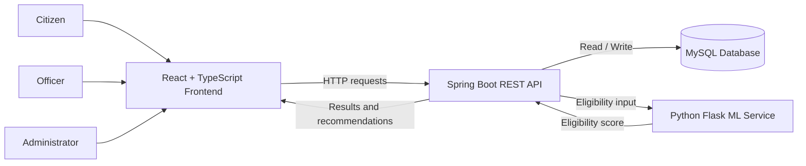

<div align="center">

# 🇮🇳 Government Welfare Advisory System

### AI-Assisted Government Scheme Discovery, Eligibility Assessment & Application Management

A full-stack platform that helps citizens discover relevant government welfare schemes, assess potential eligibility, and track applications — with dedicated workflows for citizens, officers, and administrators.

[](https://www.java.com/)
[](https://spring.io/projects/spring-boot)
[](https://react.dev/)
[](https://www.typescriptlang.org/)
[](https://www.python.org/)
[](https://www.mysql.com/)
[](https://www.docker.com/)
[](https://railway.app/)

</div>

---

## 📌 Project Overview

The **Government Welfare Advisory System** is a full-stack application designed to make government welfare schemes easier to discover and access.

Citizens can provide basic profile information — such as age, income, category, occupation, state, and other relevant attributes — to receive an ML-generated eligibility score and scheme recommendations. The backend combines the prediction response with scheme-level eligibility criteria and stores eligibility history.

The platform also provides application-management workflows:

- **Citizens** can explore schemes, check eligibility, submit applications, and track their status.
- **Officers** can review assigned or pending applications and approve or reject them with remarks.
- **Administrators** can manage schemes, users, officers, application assignments, and application-limit settings.

The project is organized as three cooperating applications: a React frontend, a Spring Boot backend, and a Python Flask prediction service.

## ✨ Key Features

### 👤 Citizen Portal
- User signup and login using mobile number or email.
- Submit personal and demographic information for an eligibility assessment.
- View eligibility score and assessment status.
- Receive scheme recommendations with matching reasons.
- View recent schemes and eligibility-check history.
- Submit applications for welfare schemes.
- Track application status and officer remarks.

### 🧑‍💼 Officer Portal
- View officer dashboard and application summaries.
- View pending applications and filter applications by status.
- Open application details.
- Approve or reject pending applications.
- Add remarks while processing applications.
- Work with applications assigned to the officer and unassigned pending applications, subject to service rules.

### 🛠️ Admin Portal
- View administrative dashboard.
- Create, update, and delete welfare schemes.
- Maintain scheme-specific details and eligibility criteria.
- View and manage users.
- Create officer accounts.
- Update user roles and account status.
- Assign applications to officers.
- Configure the application-limit setting.

### 🤖 Machine Learning Eligibility Scoring
- Python-based prediction API built with Flask.
- Model training and comparison scripts included.
- Decision Tree and Random Forest evaluation outputs included.
- Categorical feature encoding and inference preprocessing.
- Returns an `eligibility_score` to the Spring Boot backend.
- Backend converts the score into an eligibility status and combines it with scheme recommendation logic.

> **Important:** The ML score is an advisory prediction from the project's trained model. It is not an official government eligibility decision or a guarantee that an application will be approved. Final eligibility depends on current scheme rules and the responsible authority.

## 🏗️ System Architecture



### Eligibility Assessment Flow

1. A citizen submits profile details from the frontend.
2. The frontend sends the request to the Spring Boot API.
3. The backend forwards the model features to the Flask prediction service.
4. The ML service preprocesses the input and returns an eligibility score.
5. The backend maps the score to a status:
   - `ELIGIBLE` for a score greater than or equal to `0.60`.
   - `PARTIALLY_ELIGIBLE` for a score greater than or equal to `0.50` and below `0.60`.
   - `NOT_ELIGIBLE` for a score below `0.50`.
6. The scheme recommendation service checks scheme criteria and prepares matching recommendations with reasons.
7. The backend saves the assessment in eligibility history and returns the result.

## 🧰 Technology Stack

| Layer | Technologies |
|---|---|
| Frontend | React, TypeScript, Vite |
| UI Components | Radix UI, Material UI, Lucide |
| Backend | Java 17, Spring Boot 4.0.5 |
| API | Spring Web / REST |
| Persistence | Spring Data JPA, Hibernate |
| Security | Spring Security, role-based request filtering |
| Database | MySQL |
| Machine Learning | Python 3.11, Flask, scikit-learn |
| Data Processing | pandas, NumPy |
| Model Storage | joblib |
| Build Tools | Maven, npm |
| Containerization | Docker |
| CI/CD | GitHub Actions |
| Deployment Guide | Railway |

## 📂 Repository Structure

```text
Government-Welfare-Advisory-System/
│
├── backend/
│   ├── src/main/java/com/project/welfare/
│   │   ├── Entity/          # JPA entities
│   │   ├── config/          # Security, CORS and REST configuration
│   │   ├── controller/      # REST API controllers
│   │   ├── dto/             # Request and response DTOs
│   │   ├── repository/      # Data access interfaces
│   │   └── service/         # Business logic and ML integration
│   ├── src/main/resources/
│   └── pom.xml
│
├── frontend/
│   ├── src/
│   │   ├── app/
│   │   │   ├── components/
│   │   │   └── config.ts
│   │   └── styles/
│   ├── package.json
│   └── vite.config.ts
│
├── ml-model/
│   ├── api/
│   │   └── ml_service.py
│   ├── data/
│   │   └── raw/
│   ├── notebooks/
│   ├── outputs/
│   ├── src/
│   │   ├── train_model.py
│   │   └── compare_models.py
│   ├── requirements.txt
│   └── REPORT.md
│
├── database/                # SQL schema and setup scripts
├── deployment/
│   └── docker/              # Backend, frontend and ML Dockerfiles
├── .github/workflows/
│   └── ci-cd.yml
├── RAILWAY_DEPLOYMENT.md
└── README.md
```

## ⚙️ Local Setup

### Prerequisites

Install the following:

- Java Development Kit (JDK) 17
- Maven 3.8+
- Node.js 20+
- npm
- Python 3.11
- MySQL
- Git

Docker is optional for local development but useful for containerized execution.

### 1. Clone the repository

```bash
git clone https://github.com/Karthi247/Government-Welfare-Advisory-System.git
cd Government-Welfare-Advisory-System
```

### 2. Configure the MySQL database

Create a database:

```sql
CREATE DATABASE welfare_db;
```

Run the SQL scripts from the `database/` directory in the order documented in the repository's database setup.

Configure the backend environment variables:

```properties
SPRING_DATASOURCE_URL=jdbc:mysql://localhost:3306/welfare_db
SPRING_DATASOURCE_USERNAME=your_mysql_username
SPRING_DATASOURCE_PASSWORD=your_mysql_password
```

The backend currently has local development defaults in `application.properties`. Use environment variables or an external secrets manager for your own credentials; do not commit passwords.

### 3. Start the Machine Learning service

```bash
cd ml-model
python -m venv .venv
```

Activate the virtual environment:

**Windows PowerShell:**

```powershell
.venv\Scripts\Activate.ps1
```

**Linux / macOS:**

```bash
source .venv/bin/activate
```

Install dependencies:

```bash
pip install -r requirements.txt
```

The Flask API loads its trained model artifacts from `ml-model/data/processed/`. Make sure the model and encoder files expected by `api/ml_service.py` are available before starting the service.

Start the API:

```bash
python api/ml_service.py
```

Default ML service address:

```text
http://localhost:5000
```

Prediction endpoint:

```text
POST http://localhost:5000/predict
```

### 4. Start the Spring Boot backend

Open another terminal:

```bash
cd backend
mvn spring-boot:run
```

Default backend address:

```text
http://localhost:8080
```

Configure the ML endpoint using:

```properties
ML_API_URL=http://localhost:5000/predict
```

### 5. Start the React frontend

Open another terminal:

```bash
cd frontend
npm install
npm run dev
```

The frontend runs at:

```text
http://localhost:5173
```

By default, the frontend API configuration points to `http://localhost:8080`. For a different backend URL, set:

```env
VITE_API_BASE_URL=http://localhost:8080
```

Vite environment variables are read during the frontend build or dev-server startup.

## 🔌 API Overview

The Spring Boot backend exposes REST APIs grouped by responsibility.

### Authentication

| Method | Endpoint | Description |
|---|---|---|
| POST | `/api/auth/signup` | Register a user |
| POST | `/api/auth/login` | Login using mobile or email |

### Eligibility and Schemes

| Method | Endpoint | Description |
|---|---|---|
| POST | `/api/welfare/check-eligibility` | Calculate eligibility score and recommendations |
| GET | `/api/welfare/recent` | Retrieve recent schemes |
| GET | `/api/welfare/history?userId={id}` | Retrieve eligibility history |
| GET | `/api/welfare/history/{userId}` | Retrieve history for a user |

### Citizen Applications

| Method | Endpoint | Description |
|---|---|---|
| POST | `/api/applications` | Submit a scheme application |
| GET | `/api/applications/user/{userId}` | Retrieve a citizen's applications |

### Officer

| Method | Endpoint | Description |
|---|---|---|
| GET | `/api/officer/dashboard` | Officer dashboard |
| GET | `/api/officer/applications/pending` | Pending applications |
| GET | `/api/officer/applications?status=PENDING` | Filter applications by status |
| GET | `/api/officer/application/{id}` | Application details |
| PUT | `/api/officer/application/{id}/approve` | Approve an application |
| PUT | `/api/officer/application/{id}/reject` | Reject an application |

### Administrator

| Method | Endpoint | Description |
|---|---|---|
| GET | `/api/admin/dashboard` | Admin dashboard |
| GET | `/api/admin/schemes` | List schemes |
| POST | `/api/admin/schemes` | Create a scheme |
| PUT | `/api/admin/schemes/{id}` | Update a scheme |
| PUT | `/api/admin/schemes/{id}/details` | Update scheme details |
| DELETE | `/api/admin/schemes/{id}` | Delete a scheme |
| GET | `/api/admin/users` | List users |
| POST | `/api/admin/officer` | Create an officer |
| PUT | `/api/admin/user/{id}/role` | Update user role |
| PUT | `/api/admin/user/{id}/status` | Update account status |
| GET | `/api/admin/applications` | List applications |
| PUT | `/api/admin/application/{id}/assign` | Assign an officer |
| GET | `/api/admin/application-limit` | Get application-limit setting |
| PUT | `/api/admin/application-limit` | Update application-limit setting |

For request payloads, DTO fields, and implementation details, refer to the backend source code and `backend/README.md`.

## 🔐 Authentication and Security Notes

The current backend uses a custom header-based role filter for protected routes. Requests to protected endpoints are expected to include:

```http
X-User-Role: USER
X-User-Id: 1
```

Supported roles in the application include:

- `USER`
- `OFFICER`
- `ADMIN`

The Spring Security configuration applies role checks to officer, citizen application, and admin routes.

**Deployment/security caveat:** The current login implementation and header-based identity mechanism are development-oriented and should not be treated as production-grade authentication. Before handling real citizen information, implement secure password hashing, signed and verified authentication tokens or server-side sessions, strict authorization, HTTPS, and appropriate privacy protections. Never expose privileged role headers to untrusted clients.

## 🤖 Machine Learning Model

The ML directory contains model training, comparison, and inference resources.

**Input features used by the prediction service:**

- Age
- Gender
- Category
- State
- Occupation
- Annual income
- Disability indicator
- Minority indicator

**Prediction output:**

```json
{
  "eligibility_score": 0.78
}
```

The backend uses the returned score to determine the assessment status and then applies scheme-specific matching logic.

### Model Evaluation

The repository's model comparison report records the following test-set results:

| Metric | Decision Tree | Random Forest |
|---|---:|---:|
| Accuracy | 0.7777 | 0.7787 |
| Precision | 0.7169 | 0.6952 |
| Recall | 0.5590 | 0.6076 |
| F1 Score | 0.6282 | 0.6485 |
| ROC-AUC | 0.8026 | 0.8212 |

Random Forest has higher recall, F1, and ROC-AUC in the recorded evaluation; Decision Tree has slightly higher precision and is generally easier to interpret. These values are the metrics documented in `ml-model/REPORT.md`, not a guarantee of real-world eligibility accuracy.

## 🐳 Docker

The repository includes separate Dockerfiles for the backend, frontend, and ML service:

```text
deployment/docker/
├── Dockerfile_backend
├── Dockerfile_frontend
└── Dockerfile_ml
```

Build images from the repository root:

```bash
docker build -t welfare-backend -f deployment/docker/Dockerfile_backend .
docker build -t welfare-frontend -f deployment/docker/Dockerfile_frontend .
docker build -t welfare-ml -f deployment/docker/Dockerfile_ml .
```

The backend and ML services need their database and service URL environment variables configured when running as containers. The frontend needs `VITE_API_BASE_URL` configured at build time.

## 🚀 CI/CD and Deployment

The repository includes a GitHub Actions workflow at:

```text
.github/workflows/ci-cd.yml
```

The workflow is configured to:

1. Build the Spring Boot backend.
2. Install frontend dependencies and build the React application.
3. Build Docker images for the backend, frontend, and ML service.
4. Deploy the services to Railway on pushes to the configured `Lead` branch, provided the required Railway secrets are configured.

See [RAILWAY_DEPLOYMENT.md](RAILWAY_DEPLOYMENT.md) for the Railway service setup, environment variables, and GitHub Actions secrets.

## 📈 Future Enhancements

Potential improvements for a production-ready release:

- Replace development header-based identity with signed JWT or session authentication.
- Hash passwords with BCrypt or Argon2 and add secure password-reset flows.
- Add integration tests for role permissions and end-to-end eligibility assessment.
- Add model versioning, monitoring, calibration, and explainability.
- Validate scheme criteria against authoritative and up-to-date government sources.
- Add audit logs for administrative changes and officer decisions.
- Add rate limiting, structured logging, and production health monitoring.
- Improve deployment automation and publish versioned container images.

## 👨‍💻 Author

**Karthi C**

- GitHub: [@Karthi247](https://github.com/Karthi247)
- LinkedIn: [karthi-c2470](https://www.linkedin.com/in/karthi-c2470)

---

<div align="center">

**Built to make welfare scheme discovery more accessible through software and data-driven assistance.**

</div>
